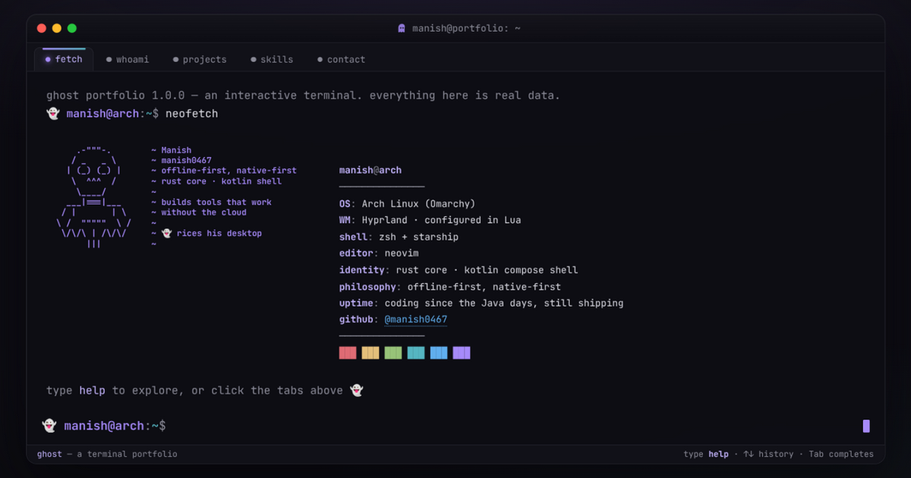

# 👻 portfolio — a terminal you can talk to

  

My personal portfolio, built as a **Ghostty-inspired terminal window**. It's not a
screenshot of a terminal — it *is* one: type commands, flip tabs, scroll history.

## Try it

Open **[manish0467.github.io/portfolio](https://manish0467.github.io/portfolio/)** and type:

| Command | What you get |
|---|---|
| `neofetch` | who I am, system-info style (also: `fastfetch`) |
| `projects` / `project moviebox-android` | what I've built, with links |
| `skills` | the toolbox |
| `demo` | the terminal drives itself — a 15-second tour |
| `theme` | dark ⇄ light, remembered across visits |
| `ghost` · `vim` · `sudo make me a sandwich` · ↑↑↓↓←→←→BA | 👻 |

Arrow keys recall history, Tab completes commands, Ctrl+L clears — the muscle
memory all works.

## How it's built

One self-contained `index.html`: vanilla HTML/CSS/JS, no framework, no build step,
no dependencies beyond a webfont. Deployed on GitHub Pages from `main` — every push
is live in about a minute. The social preview card (`og.png`) is a screenshot of the
site itself, captured from a real browser.

## License

[MIT](LICENSE)
